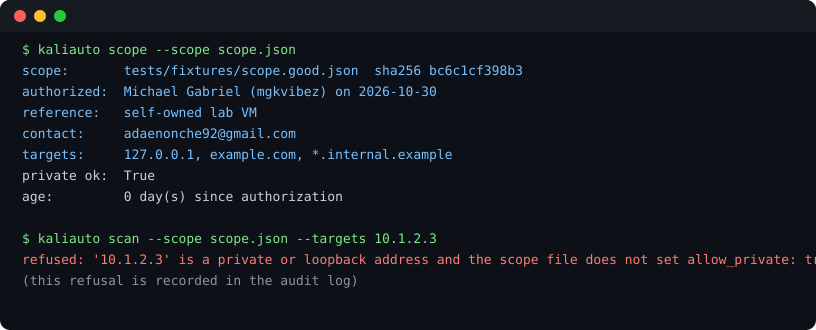

# kali-auto-suite

**Authorized, non-destructive reconnaissance, orchestrated.** Scope-gated, dry-run by default, every attempt audited. Repo `kali-auto-suite`; command and package `kaliauto`.



[](https://github.com/mgkvibez/kali-auto-suite/actions/workflows/ci.yml)
[](LICENSE)
[](pyproject.toml)

## What this is, and what it is deliberately not

This is the boring, defensible half of penetration testing: the recon you would run against systems **you own or are contracted to test**. It exists because the risky part of scanner automation is rarely the scanner. It is the run nobody wrote down, against a host nobody cleared, at a rate nobody capped.

It is **not** an exploitation framework. There are no exploit modules, no credential attacks, no brute forcing, no denial of service, no payloads, and no plugin surface. The four modules are fixed in code. If you want that other thing, this is the wrong tool, on purpose.

## The three rules the code enforces

1. **No scope file, no run.** The scope file names a human (`authorized_by`), a date, a contact and a reference. If any of those is missing, every command refuses and exits 4. There is no flag that skips it.
2. **Dry run is the default.** `kaliauto scan` prints exactly what it would do and sends nothing. Traffic requires `--execute`, given deliberately.
3. **Everything is audited.** `.kaliauto/audit.jsonl` gets one JSON line per plan, per module start, per skip and per **refusal**. A refused run is evidence too, which is why refusals are recorded rather than dying quietly.

Private and loopback ranges additionally require `"allow_private": true`, because "my lab" and "my production network" are not the same permission.

## Use

```bash
cp scope.example.json scope.json     # fill in who authorized what, honestly
kaliauto scope --scope scope.json    # validate it, see the fingerprint and age
kaliauto scan  --scope scope.json    # dry run: prints the plan, sends nothing
kaliauto scan  --scope scope.json --execute --max-rate 0.5 --json
```

Exit codes are a contract: `0` clean or dry run, `3` findings, `4` refused, `5` a module's dependency is missing, `2` bad invocation.

## What it checks

| Module | Checks | Needs |
|---|---|---|
| `dns` | resolves at all, SPF, DMARC, CAA | `dig` for TXT/CAA |
| `tls` | expiry, expiry under 30 days, protocol below 1.2, verification failure | nothing |
| `headers` | HSTS, CSP, nosniff, clickjacking protection, version banners | nothing |
| `ports` | risky open ports on the top 100 (`-sT -Pn`, no scripts, fixed flags) | `nmap` |

Targets are validated as hostnames, IPs or CIDR ranges before they can reach an argv list, and the shell is never involved: `subprocess.run` gets a list. A target containing shell metacharacters is refused as `UnsafeTarget`, not sanitized and hoped over.

## Honest limits

- The `ports` module only ever runs one fixed nmap invocation: no `-A`, no `-O`, no NSE scripts, no version probing. That is a deliberate ceiling, not a missing feature.
- `dig` and `nmap` are optional. When absent the module is skipped and said to be skipped, never quietly reported as clean.
- Findings are bounded by `checkset v1`: a clean run prints `No issues found by checkset v1`, because silence from twelve checks is not a statement about safety.
- This is not a substitute for a real engagement process. It records what you did; it cannot tell you whether you were allowed to.

## Tests

50 tests, no network access. Grading functions are pure (a certificate dict or header map in, findings out), and every module accepts an injected runner, so the suite proves behaviour without touching a host. The scope and CLI tests are adversarial: out-of-scope targets, missing authorization fields, private ranges without opt-in, shell metacharacters in targets, and a dry run that fails the test if a module is executed at all.

`scripts/verify.sh` is the gate CI runs.

## License

MIT.
